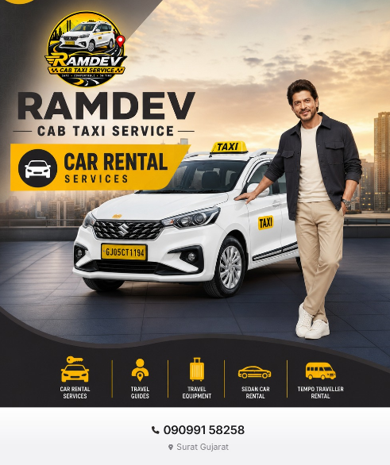

<div align="center">




# 🚖 Ramdev Cab Taxi Service: Digital Launch Kit

**Safe · Comfortable · 24 Time | Car Rental, Sedan, Tempo Traveller & Travel Guides | Surat, Gujarat**

[](tel:+919099158258)
[](https://www.instagram.com/ramdev_cab/)
[](https://desidevloper.com)
[](https://wa.me/919727413309)


**Automate What's Costing You Money.**

</div>

---

## 📦 What this repo is

The delivery tracker and asset hub for the **Ramdev Cab Taxi Service** (owner: Kishor) 1-week digital setup, delivered by **SNTL 84**.

| | |
|---|---|
| **Client** | Ramdev Cab Taxi Service, Surat, Gujarat |
| **Owner** | Kishor |
| **Client phone** | [09099 158258](tel:+919099158258) |
| **Client Instagram** | [@ramdev_cab](https://www.instagram.com/ramdev_cab/) |
| **Package price** | ₹15,000 (total setup) |
| **Timeline** | 1 week |

## ✅ Scope of work

| # | Deliverable | Status |
|---|---|---|
| 1 | Google Business Profile | ⬜ Pending |
| 2 | Instagram account setup and optimisation ([@ramdev_cab](https://www.instagram.com/ramdev_cab/)) | ⬜ Pending |
| 3 | Facebook Page | ⬜ Pending |
| 4 | WhatsApp Business channel | ⬜ Pending |
| 5 | YouTube channel | ⬜ Pending |
| 6 | JustDial, TradeIndia-type trade enquiry and IndiaMART enquiry setup | ⬜ Pending |
| 7 | Porter app registration | ⬜ Pending |
| 8 | Business registration and permit guidance for cab/taxi app revenue | ⬜ Pending |
| 9 | 999 local leads, Surat | ⬜ Pending |
| 10 | Existing creatives edited, curated and aligned to the cab profession | ⬜ Pending |
| 11 | AI videos with the owner, with consistent links, posts and creatives on every platform | ⬜ Pending |
| 12 | Minimum 60 taxi FAQs | ✅ [68 FAQs done](FAQ.md) |

> Platform links are added here as each profile goes live. Only live links are published so every button works.

## 🗂️ Repo structure

```text
RamdevCab/
├── README.md
├── FAQ.md                    # 68 taxi FAQs
├── docs/
│   └── PROJECT_SCOPE.md      # scope, timeline, checklist
├── assets/                   # MADS logo, Ramdev creative, SNTL 84 banner
├── create_repo.sh            # creates repo + topics + homepage via GitHub CLI
└── LICENSE
```

## 🖼️ Brand assets

| Asset | Preview |
|---|---|
| MADS (Metro Ad Services) logo |  |
| Ramdev Cab Taxi Service creative |  |
| SNTL 84 banner |  |

## 🎨 Brand

| Token | Value |
|---|---|
| Dark | `#0B0F19` |
| Amber (SNTL 84) | `#F59E0B` |
| Taxi yellow (Ramdev Cab) | `#FFC20E` |

# Ramdev Cab Taxi Service: Frequently Asked Questions

Surat, Gujarat | Call 09099 158258 | Instagram [@ramdev_cab](https://www.instagram.com/ramdev_cab/)
> Fares, availability and policies are confirmed at booking. Items marked as general guidance should be reviewed by the owner (Kishor) before publishing.

**68 questions** across 6 topics: booking and contact, services, fares and payments, vehicles and safety, Surat and Gujarat travel, and trust, support and business. Use the index below to jump straight to your question.

## 📑 Index

- **[Booking & Contact](#booking--contact)** (FAQs 1 to 10)
  - [1. How do I book a cab with Ramdev Cab Taxi Service?](#1-how-do-i-book-a-cab-with-ramdev-cab-taxi-service)
  - [2. What is the contact number of Ramdev Cab Taxi Service?](#2-what-is-the-contact-number-of-ramdev-cab-taxi-service)
  - [3. Where is Ramdev Cab Taxi Service based?](#3-where-is-ramdev-cab-taxi-service-based)
  - [4. Who is the owner of Ramdev Cab Taxi Service?](#4-who-is-the-owner-of-ramdev-cab-taxi-service)
  - [5. Do you take advance bookings?](#5-do-you-take-advance-bookings)
  - [6. Can I book a taxi at the last minute?](#6-can-i-book-a-taxi-at-the-last-minute)
  - [7. Is the service available 24 hours?](#7-is-the-service-available-24-hours)
  - [8. What details are needed to confirm a booking?](#8-what-details-are-needed-to-confirm-a-booking)
  - [9. How will I get my booking confirmation?](#9-how-will-i-get-my-booking-confirmation)
  - [10. Can I modify or cancel my booking?](#10-can-i-modify-or-cancel-my-booking)
- **[Services](#services)** (FAQs 11 to 22)
  - [11. What services does Ramdev Cab offer?](#11-what-services-does-ramdev-cab-offer)
  - [12. Do you offer sedan car rental?](#12-do-you-offer-sedan-car-rental)
  - [13. Do you offer tempo traveller rental?](#13-do-you-offer-tempo-traveller-rental)
  - [14. Do you provide travel guides?](#14-do-you-provide-travel-guides)
  - [15. What is travel equipment support?](#15-what-is-travel-equipment-support)
  - [16. Do you offer local city rental in Surat?](#16-do-you-offer-local-city-rental-in-surat)
  - [17. Do you offer outstation cabs from Surat?](#17-do-you-offer-outstation-cabs-from-surat)
  - [18. Do you provide airport pickup and drop?](#18-do-you-provide-airport-pickup-and-drop)
  - [19. Do you provide cabs for weddings and events?](#19-do-you-provide-cabs-for-weddings-and-events)
  - [20. Do you provide cabs for corporate travel?](#20-do-you-provide-cabs-for-corporate-travel)
  - [21. Can I hire a car with a driver for a full day?](#21-can-i-hire-a-car-with-a-driver-for-a-full-day)
  - [22. Do you offer pilgrimage and religious tour cabs?](#22-do-you-offer-pilgrimage-and-religious-tour-cabs)
- **[Fares & Payments](#fares--payments)** (FAQs 23 to 32)
  - [23. How is the taxi fare calculated?](#23-how-is-the-taxi-fare-calculated)
  - [24. Is there a fixed price for Surat local rental?](#24-is-there-a-fixed-price-for-surat-local-rental)
  - [25. How is outstation fare charged?](#25-how-is-outstation-fare-charged)
  - [26. Are toll and parking charges included?](#26-are-toll-and-parking-charges-included)
  - [27. Is there driver allowance on outstation trips?](#27-is-there-driver-allowance-on-outstation-trips)
  - [28. What payment methods are accepted?](#28-what-payment-methods-are-accepted)
  - [29. Do you provide a bill or receipt?](#29-do-you-provide-a-bill-or-receipt)
  - [30. Is advance payment required?](#30-is-advance-payment-required)
  - [31. Are there extra charges for night travel?](#31-are-there-extra-charges-for-night-travel)
  - [32. Do you charge waiting time?](#32-do-you-charge-waiting-time)
- **[Vehicles & Safety](#vehicles--safety)** (FAQs 33 to 44)
  - [33. What types of vehicles are available?](#33-what-types-of-vehicles-are-available)
  - [34. Are your cars clean and well maintained?](#34-are-your-cars-clean-and-well-maintained)
  - [35. Are the cars air conditioned?](#35-are-the-cars-air-conditioned)
  - [36. How many passengers can a sedan carry?](#36-how-many-passengers-can-a-sedan-carry)
  - [37. How many passengers can a tempo traveller carry?](#37-how-many-passengers-can-a-tempo-traveller-carry)
  - [38. Is luggage space available?](#38-is-luggage-space-available)
  - [39. Are your drivers experienced?](#39-are-your-drivers-experienced)
  - [40. Are your vehicles commercially registered taxis?](#40-are-your-vehicles-commercially-registered-taxis)
  - [41. Is travel with Ramdev Cab safe for women and families?](#41-is-travel-with-ramdev-cab-safe-for-women-and-families)
  - [42. Do you have child seats?](#42-do-you-have-child-seats)
  - [43. Can senior citizens travel comfortably?](#43-can-senior-citizens-travel-comfortably)
  - [44. Is a first aid kit available in the car?](#44-is-a-first-aid-kit-available-in-the-car)
- **[Surat & Gujarat Travel](#surat--gujarat-travel)** (FAQs 45 to 56)
  - [45. Can I book a taxi from Surat to Ahmedabad?](#45-can-i-book-a-taxi-from-surat-to-ahmedabad)
  - [46. Can I book a taxi from Surat to Mumbai?](#46-can-i-book-a-taxi-from-surat-to-mumbai)
  - [47. Can I book a taxi from Surat to Vadodara?](#47-can-i-book-a-taxi-from-surat-to-vadodara)
  - [48. Can I book a taxi from Surat to Saputara?](#48-can-i-book-a-taxi-from-surat-to-saputara)
  - [49. Can I book a taxi from Surat to Dwarka or Somnath?](#49-can-i-book-a-taxi-from-surat-to-dwarka-or-somnath)
  - [50. Can I book a taxi from Surat to Statue of Unity?](#50-can-i-book-a-taxi-from-surat-to-statue-of-unity)
  - [51. Do you cover Dumas, Dandi and Ubharat beach trips?](#51-do-you-cover-dumas-dandi-and-ubharat-beach-trips)
  - [52. Do you provide Surat railway station pickup and drop?](#52-do-you-provide-surat-railway-station-pickup-and-drop)
  - [53. Do you provide Surat airport transfers?](#53-do-you-provide-surat-airport-transfers)
  - [54. Do you serve areas outside Surat city, like Kamrej, Sachin and Bardoli?](#54-do-you-serve-areas-outside-surat-city-like-kamrej-sachin-and-bardoli)
  - [55. Can I hire a taxi for a multi-day Gujarat tour?](#55-can-i-hire-a-taxi-for-a-multi-day-gujarat-tour)
  - [56. Do you offer Rajasthan or Maharashtra tours?](#56-do-you-offer-rajasthan-or-maharashtra-tours)
- **[Trust, Support & Business](#trust-support--business)** (FAQs 57 to 68)
  - [57. Why choose Ramdev Cab Taxi Service?](#57-why-choose-ramdev-cab-taxi-service)
  - [58. How can I give feedback or a review?](#58-how-can-i-give-feedback-or-a-review)
  - [59. What if my driver is late?](#59-what-if-my-driver-is-late)
  - [60. What if I lose an item in the cab?](#60-what-if-i-lose-an-item-in-the-cab)
  - [61. Can I get a vehicle for a one-way drop only?](#61-can-i-get-a-vehicle-for-a-one-way-drop-only)
  - [62. Can I book through WhatsApp or Instagram?](#62-can-i-book-through-whatsapp-or-instagram)
  - [63. Do you offer regular monthly contracts for offices or schools?](#63-do-you-offer-regular-monthly-contracts-for-offices-or-schools)
  - [64. Can travel agents or tour operators partner with you?](#64-can-travel-agents-or-tour-operators-partner-with-you)
  - [65. Are you listed on Google, JustDial, IndiaMART and TradeIndia?](#65-are-you-listed-on-google-justdial-indiamart-and-tradeindia)
  - [66. Are you on Porter?](#66-are-you-on-porter)
  - [67. How do I follow Ramdev Cab for updates and offers?](#67-how-do-i-follow-ramdev-cab-for-updates-and-offers)
  - [68. What areas of Surat do you cover?](#68-what-areas-of-surat-do-you-cover)

---

## Booking & Contact

[⬆ Back to index](#-index)

### 1. How do I book a cab with Ramdev Cab Taxi Service?

Booking takes only a few minutes. You can:

- **Call 09099 158258**: the fastest option, especially for same-day or urgent trips.
- **Message on Instagram [@ramdev_cab](https://www.instagram.com/ramdev_cab/)**: suitable for planned trips where you want the details in writing.

Share your pickup point, destination, travel date and time, number of passengers and preferred vehicle (sedan, family car or tempo traveller). You then receive a confirmation with the vehicle, driver and fare details before the trip. For weddings, airport transfers, outstation trips and festival-season travel, book as early as you can.

### 2. What is the contact number of Ramdev Cab Taxi Service?

Our contact number is **09099 158258**. Use it for new bookings, fare quotes, changes to an existing booking and support during a trip. Calling is the quickest route for urgent requests. For planned trips and general questions, you can also message us on Instagram at @ramdev_cab. Saving the number in your phone before travel helps you reach us instantly if plans change.

### 3. Where is Ramdev Cab Taxi Service based?

Ramdev Cab Taxi Service is based in **Surat, Gujarat, India**. We serve Surat city and nearby areas, and run outstation trips across Gujarat and to neighbouring states. Being a local Surat operator means we are familiar with city roads, the railway station and airport routes, and everyday traffic patterns, which helps with accurate pickup timing.

### 4. Who is the owner of Ramdev Cab Taxi Service?

The service is run by its owner, **Kishor**. Bookings, quotes and special arrangements such as corporate contracts, wedding transport and travel-agent tie-ups can be discussed directly with the owner on 09099 158258. Direct owner involvement keeps decisions quick and responsibility clear.

### 5. Do you take advance bookings?

Yes, and advance booking is recommended. It matters most for:

- Weddings, baraat transport and event shuttles
- Early-morning or late-night airport and railway transfers
- Outstation and multi-day tours
- Tempo traveller trips for large groups
- Festival and holiday periods, when demand is high

Booking early lets us assign the right vehicle and driver for your date. For large events and multi-day tours, booking a week or more ahead is sensible. Share exact dates and timings so they can be noted in your confirmation.

### 6. Can I book a taxi at the last minute?

Yes, subject to vehicle availability. For same-day or urgent trips, **call 09099 158258** rather than sending a message, so we can check availability immediately. Keep these ready: exact pickup location, destination, number of passengers and luggage. If your preferred vehicle type is not free at that moment, we can suggest the closest suitable alternative.

### 7. Is the service available 24 hours?

Yes, Ramdev Cab advertises **24-hour service**. For night and early-morning pickups, such as early flights or late train arrivals, pre-booking is the safest way to make sure a driver and vehicle are ready at your time. Share your flight or train details, and note that night charges may apply on certain trips (see FAQ 31). Sharing the driver and vehicle details with a family member is a good habit for night travel.

### 8. What details are needed to confirm a booking?

To confirm quickly and quote accurately, please share:

- Your name and phone number
- Pickup address (a map pin or landmark helps)
- Drop location
- Travel date and time
- Number of passengers
- Luggage details
- Preferred vehicle type, and whether you want AC
- Trip type: local, airport or station transfer, one-way or round-trip outstation

For multi-day trips, add your itinerary and return plan.

### 9. How will I get my booking confirmation?

Confirmation is shared by **call, SMS or WhatsApp** and includes the driver and vehicle details along with your pickup time and fare information. Please read it once and check the date, time, pickup point and vehicle type. If anything looks wrong, or you have not received a confirmation, call 09099 158258 so it can be corrected before the trip.

### 10. Can I modify or cancel my booking?

Yes. Please inform us **as early as possible** if your date, time, pickup point, passenger count or vehicle type changes, so we can adjust the booking and free up the vehicle if you cancel. Cancellation terms are explained at booking time. For outstation trips and events that involve an advance payment, ask about the cancellation and refund terms when you book so everything is clear in advance.

## Services

[⬆ Back to index](#-index)

### 11. What services does Ramdev Cab offer?

Ramdev Cab offers, from Surat:

- Local city car rental (hourly, half-day and full-day)
- Outstation cabs, one-way and round-trip
- Sedan car rental
- Tempo traveller rental for groups
- Airport and railway station transfers
- Wedding and event transport
- Corporate and monthly travel
- Pilgrimage and multi-day tours
- Travel guide and travel equipment support on request

If your requirement is not listed, call 09099 158258 and we will tell you what can be arranged.

### 12. Do you offer sedan car rental?

Yes. Sedans are a practical, comfortable choice for couples, small families and business travellers, and they are available for city, airport and outstation trips. A sedan usually seats up to 4 passengers with luggage (see FAQ 36). For larger groups or heavy luggage, an MPV, SUV-type family car or tempo traveller is the better fit.

### 13. Do you offer tempo traveller rental?

Yes. Tempo travellers suit family groups, corporate outings, wedding guests, pilgrimages and sightseeing tours. Seating varies by model, commonly 12 to 17 passengers (see FAQ 37). When booking, mention your group size, luggage, route and whether you need AC, so the right vehicle is assigned.

### 14. Do you provide travel guides?

Yes, local travel guide support can be arranged for sightseeing trips **on request**. This is useful for temple circuits, heritage sites, hill stations and beach destinations. Tell us your destination, number of days and group profile when booking. Any guide arrangement and related charges are confirmed in your quote before the trip.

### 15. What is travel equipment support?

Travel equipment support means arranging items that make a trip easier, such as luggage carriers for extra bags, on request. Availability depends on the vehicle and the trip. Please mention what you need while booking, and we will confirm whether it can be arranged and whether any charge applies.

### 16. Do you offer local city rental in Surat?

Yes. Hourly, half-day and full-day packages are available within Surat. They suit shopping trips, business meetings, family visits, errands and temple rounds. Tell us how many hours you need and the areas you will cover. Package rates depend on vehicle type, and extra hours or kilometres beyond the package are billed as per the rate card shared at booking (see FAQ 24).

### 17. Do you offer outstation cabs from Surat?

Yes. **One-way and round-trip** outstation cabs are available from Surat across Gujarat and to nearby states. Share your route, dates and return plan so we can quote correctly. Outstation quotes typically cover distance, a daily minimum, driver allowance, tolls and taxes, and the exact terms are confirmed before the trip (see FAQs 25 to 27).

### 18. Do you provide airport pickup and drop?

Yes. Airport and railway station transfers are available. Share your **flight or train details** so pickup timing can be planned around your arrival, and give your exact pickup or drop address. Early-morning and late-night transfers should be pre-booked. Allow some buffer time for Surat traffic when you plan a drop for a flight or train.

### 19. Do you provide cabs for weddings and events?

Yes. Vehicles can be booked for wedding guests, baraat transport, bride and groom travel and event shuttles. To plan well, share the number of vehicles needed, event dates and timings, venues and routes. Book early, as wedding dates fill up fast. Ask for an event-specific quote when you have a multi-vehicle or multi-day requirement.

### 20. Do you provide cabs for corporate travel?

Yes. **Monthly and per-trip corporate arrangements** are possible for staff pickups, client airport transfers, site visits and business trips. Contact us at 09099 158258 with your travel pattern (routes, frequency, vehicle type) and we will propose a custom plan. Trip bills can be provided on request (see FAQ 29).

### 21. Can I hire a car with a driver for a full day?

Yes. Full-day car-with-driver packages are available for meetings, shopping, sightseeing and family functions. Tell us your start time, end time and areas to be covered so the right package is quoted. Hours or kilometres beyond the package are charged as per the rate card shared at booking.

### 22. Do you offer pilgrimage and religious tour cabs?

Yes. Taxis and tempo travellers can be arranged for temple and pilgrimage tours, including multi-day routes such as Dwarka and Somnath (see FAQ 49). Share your itinerary, group size and any needs of senior travellers (see FAQ 43). Pre-booking is recommended, especially around festivals and holidays.

## Fares & Payments

[⬆ Back to index](#-index)

### 23. How is the taxi fare calculated?

Fare depends on four main factors: **vehicle type, distance, duration and trip type** (local, airport transfer, one-way or round-trip outstation). Tolls, parking, driver allowance and night charges may apply in addition, depending on the trip (see FAQs 26, 27 and 31). For an exact quote, call **09099 158258** and share your full itinerary, since accurate trip details lead to an accurate quote.

### 24. Is there a fixed price for Surat local rental?

Local rentals are priced as packages, **per hour or per day, by vehicle type**. Rates can change with the vehicle and the season, so please ask for the current rate card. When you get the quote, confirm what the package includes (hours and kilometres) and how extra time or distance is charged.

### 25. How is outstation fare charged?

Outstation fares are typically based on **kilometres travelled with a daily minimum**, plus driver allowance and any applicable tolls and taxes. Round trips are usually calculated on the total distance with a daily minimum, while one-way drops are quoted for the specific route. All terms are confirmed before the trip, so ask for the quote to include what is and is not covered.

### 26. Are toll and parking charges included?

This is clarified at booking. Usually, **tolls and parking are paid as actuals** unless a package states otherwise. If you prefer an all-inclusive price, ask for it when requesting your quote. For inter-state trips, also confirm border tax and permit charges (see FAQ 46).

### 27. Is there driver allowance on outstation trips?

Driver allowance may apply on **multi-day or night trips**, to cover the driver's stay and meals. It is confirmed in your quote, so you will know the amount before the trip begins. Ask whether it is already included in the quoted price or charged separately.

### 28. What payment methods are accepted?

We accept **cash and common UPI payment methods**. Please confirm your preferred mode when booking, particularly if an advance is required. For larger trips and corporate arrangements, discuss payment terms with the owner in advance.

### 29. Do you provide a bill or receipt?

Yes, a trip bill can be provided **on request**. This is helpful for corporate reimbursements and business travel. If you need specific billing details, such as a company name, mention it when booking so the bill is prepared correctly.

### 30. Is advance payment required?

An advance may be requested for **long outstation trips or large events**, to secure the vehicle for your dates. Short local trips may not need one. The amount and how it is adjusted in the final bill are confirmed at booking, so ask for these details to be included in your confirmation message.

### 31. Are there extra charges for night travel?

Night charges **may apply on certain trips**, such as late-night or early-morning journeys. If they apply, they will be mentioned in your quote. For airport and railway transfers at odd hours, ask about night charges while booking so there are no surprises.

### 32. Do you charge waiting time?

A **free waiting window may apply**, after which waiting charges are applied. The exact window and rate depend on the trip and are explained at booking. To avoid waiting charges, share realistic timings and inform us if you are delayed. For events and multi-stop trips, ask for a package that already accounts for waiting.

## Vehicles & Safety

[⬆ Back to index](#-index)

### 33. What types of vehicles are available?

We offer **sedans, MPV or SUV-type family cars and tempo travellers**, subject to availability. Choose by group size and luggage: sedans for up to 4 passengers, family cars for slightly larger groups with luggage, and tempo travellers for big groups. Mention your preferred type when booking and we will confirm what is available for your date.

### 34. Are your cars clean and well maintained?

Yes. Vehicles are **cleaned and checked before trips**. If you have particular needs, such as extra cleanliness for a family trip or a special occasion, mention them at booking. If anything is not up to the mark, call 09099 158258 so we can address it promptly.

### 35. Are the cars air conditioned?

Yes, **AC vehicles are available**. Please mention your AC preference while booking, as it helps assign the right vehicle and lets us quote accurately, especially for long outstation trips and during Surat's hot months.

### 36. How many passengers can a sedan carry?

A sedan usually carries **up to 4 passengers with luggage**. If you have 5 or more travellers, or several large bags, choose an MPV, SUV-type family car or tempo traveller so everyone travels comfortably. Share your passenger and luggage count and we will recommend the right vehicle.

### 37. How many passengers can a tempo traveller carry?

Seating varies by model, **commonly 12 to 17 passengers**. Please confirm the seating you need when booking, along with your luggage, so a suitable tempo traveller is assigned. For long routes, mention whether you want AC and any comfort preferences.

### 38. Is luggage space available?

Yes. Luggage space depends on the vehicle. Sedans take a few bags with 4 passengers, while MPVs and tempo travellers offer more room. **Share your luggage count** (number of bags and any oversized items) so the right vehicle can be assigned. For extra luggage, ask about a luggage carrier (see FAQ 15).

### 39. Are your drivers experienced?

Drivers are **experienced with Surat and Gujarat routes** and are briefed on safe, courteous service. Your driver's name and contact details are shared in your booking confirmation. If you have feedback on a driver, tell us so we can act on it (see FAQ 58).

### 40. Are your vehicles commercially registered taxis?

Taxi vehicles carry taxi branding, as seen in our creatives. Commercial passenger vehicles in India are typically identified by yellow number plates. **Registration and permit details can be shared on request**, so you can ask for them before the trip if you want to verify.

### 41. Is travel with Ramdev Cab safe for women and families?

Safety and comfort are priorities. To add to your peace of mind:

- Ask for the **driver's name and vehicle number** in your confirmation, and share them with family.
- Share your **live location** with a trusted person during the trip.
- For night travel, pre-book so your vehicle and driver are confirmed in advance.
- Call 09099 158258 anytime during the trip if you need help.

### 42. Do you have child seats?

Please **ask in advance**. Availability depends on the vehicle. If you are travelling with infants or young children, tell us at booking so we can confirm what can be arranged, and consider carrying your own child seat for long trips if one is essential for you.

### 43. Can senior citizens travel comfortably?

Yes. **Mention seniors when booking** so a comfortable vehicle can be assigned and assistance can be planned, such as help with boarding, luggage and well-timed rest stops on long routes. For pilgrimage and outstation trips, we can discuss a relaxed schedule suited to elderly travellers.

### 44. Is a first aid kit available in the car?

Please **request it while booking**. Availability depends on the vehicle. For long outstation and hill-station trips, it is sensible to ask for one in advance, and to carry any personal medicines you need.

## Surat & Gujarat Travel

[⬆ Back to index](#-index)

### 45. Can I book a taxi from Surat to Ahmedabad?

Yes. Surat to Ahmedabad **one-way and round trips** are available. The distance is roughly 265 km, which is typically a drive of about 4.5 to 5 hours depending on traffic. Share your travel date, pickup point and whether you need a return so we can quote accordingly.

### 46. Can I book a taxi from Surat to Mumbai?

Yes. Surat to Mumbai cabs are available. The distance is roughly 280 to 290 km, usually about 5 to 6 hours depending on traffic. As this is an **inter-state trip**, toll and permit charges are confirmed in your quote. Ask for the full cost in writing before travel.

### 47. Can I book a taxi from Surat to Vadodara?

Yes. Surat to Vadodara cabs are available as one-way or round trips. The distance is roughly 150 km, typically a drive of about 2 to 2.5 hours. It works well for business visits, railway connections and day trips. Share your timings and return plan for an accurate quote.

### 48. Can I book a taxi from Surat to Saputara?

Yes. **Saputara hill station** trips are available as one-day or overnight packages. The route is roughly 160 to 170 km from Surat, and the drive is usually about 4 hours. An overnight stay is recommended for a relaxed visit. Share your group size and dates, and mention if you need a travel guide (see FAQ 14).

### 49. Can I book a taxi from Surat to Dwarka or Somnath?

Yes. **Multi-day Saurashtra pilgrimage trips** can be arranged. These are long routes of roughly 600 to 700 km each way, so they are best planned over several days with night halts. Share your itinerary, number of travellers and any senior or child needs, and we will build a suitable plan and quote. Pre-booking is strongly recommended.

### 50. Can I book a taxi from Surat to Statue of Unity?

Yes. **Statue of Unity** trips can be arranged as a day trip or with an overnight stay. The distance is roughly 160 to 180 km each way, so a day trip means an early start. For a relaxed visit with time at the site, consider an overnight option. Tell us your group size and preferred schedule.

### 51. Do you cover Dumas, Dandi and Ubharat beach trips?

Yes. **Local day-trip packages to nearby beaches** are available. Dumas is closest to Surat, while Dandi and Ubharat are a longer drive along the coast. Share your group size, pickup time and expected return so we can quote a suitable package. Weekends and holidays are busy, so pre-book.

### 52. Do you provide Surat railway station pickup and drop?

Yes. Share your **train number and arrival time** (or departure time for a drop) and your address, so pickup timing can be planned around your journey. For early-morning and late-night trains, pre-booking is recommended. Mention the exact station you are using so the driver goes to the right place.

### 53. Do you provide Surat airport transfers?

Yes. **Pickup and drop for Surat Airport** are available. Share your flight details and address. For a drop, allow buffer time for city traffic before check-in. For early-morning flights, pre-book your cab so your driver is ready on time.

### 54. Do you serve areas outside Surat city, like Kamrej, Sachin and Bardoli?

Yes. Pickups and drops in **nearby towns** such as Kamrej, Sachin and Bardoli can be arranged. Share your exact pickup address and drop location when you call, and we will confirm availability and the fare for your route.

### 55. Can I hire a taxi for a multi-day Gujarat tour?

Yes. **Custom multi-day itineraries** are available with a driver and an optional guide. Tell us your places of interest, number of days, group size and comfort needs. We will help shape a route and give you a quote that clearly lists what is included, such as kilometres, driver allowance, tolls and taxes.

### 56. Do you offer Rajasthan or Maharashtra tours?

Yes. **Inter-state tours** to destinations in Rajasthan and Maharashtra can be arranged. Permit and toll charges are shared in advance, so you know the full cost before you commit. These trips need more planning, so share your itinerary and dates as early as possible.

## Trust, Support & Business

[⬆ Back to index](#-index)

### 57. Why choose Ramdev Cab Taxi Service?

Here is what you get with us:

- A **local Surat operator** familiar with city and regional routes
- **Direct owner contact** for quick decisions
- **Clean, checked vehicles**
- **Transparent quotes** confirmed before the trip
- **24-hour support** for bookings and trip help

Call 09099 158258 to experience it.

### 58. How can I give feedback or a review?

We value feedback, good or bad. Message us on Instagram **@ramdev_cab**, or call 09099 158258. You can also leave a **Google review** once our Google Business Profile is live. Specific feedback about your vehicle, driver or timing helps us improve.

### 59. What if my driver is late?

Call **09099 158258** and we will update you on the driver's status or arrange an alternative immediately. To reduce the chance of delays, share an accurate pickup location and be reachable on your phone around pickup time.

### 60. What if I lose an item in the cab?

Call us **as soon as possible** with your trip details (date, time, pickup and drop points, and the driver or vehicle details if you have them) and a description of the item. We will help you recover it. Calling quickly improves the chance of a smooth recovery.

### 61. Can I get a vehicle for a one-way drop only?

Yes. **One-way drop options** are available on many routes. Share your pickup and drop locations and the date, and we will confirm availability and quote. One-way pricing differs from round trips (see FAQ 25), so ask for the exact terms.

### 62. Can I book through WhatsApp or Instagram?

Yes, messages are accepted through **WhatsApp and Instagram**. Calling is fastest for urgent requests, and messaging works well for planned trips because the details stay in writing. A dedicated WhatsApp Business channel is being set up (see FAQ 67).

### 63. Do you offer regular monthly contracts for offices or schools?

Yes. **Contract rates for regular monthly travel** can be discussed with the owner. Share your routes, timings, number of passengers, vehicle type and the duration of the arrangement, and a plan can be proposed. This suits offices, schools, staff pickups and other recurring needs.

### 64. Can travel agents or tour operators partner with you?

Yes. Contact us for **B2B rates and vehicle tie-ups**. Share your typical routes, group sizes, season and volumes, and the owner will discuss a partnership that works for both sides.

### 65. Are you listed on Google, JustDial, IndiaMART and TradeIndia?

Business listings are **being set up** on Google Business Profile, JustDial, IndiaMART and trade enquiry platforms, so that customers can find us more easily. Each listing will go live as it is completed. Until then, the quickest way to reach us is to call 09099 158258 or message @ramdev_cab on Instagram.

### 66. Are you on Porter?

Registration with the **Porter app** is part of our growth plan, to serve additional logistics and vehicle demand. It is being planned as part of our wider digital setup. For current bookings, please contact us directly on 09099 158258.

### 67. How do I follow Ramdev Cab for updates and offers?

Follow **[@ramdev_cab](https://www.instagram.com/ramdev_cab/) on Instagram** for updates and offers. Our **Facebook page, YouTube channel and WhatsApp Business channel** are being set up and will be shared as each goes live.

### 68. What areas of Surat do you cover?

We cover **Surat city and surrounding areas**, including Adajan, Vesu, Varachha, Katargam, Udhna and Pal, plus outstation routes. If your area is not listed, call us with your pickup location and we will confirm.

---

## ❓ Still have a question?

Call **09099 158258** or message [@ramdev_cab](https://www.instagram.com/ramdev_cab/) on Instagram with your trip details and we will help.

[⬆ Back to index](#-index)

---

<div align="center">

### 🤝 Collab: What's Costing You Time

**SNTL 84 | Agentic AI Workflow Professional**
Performance Marketing Service · Fulfillment Automation · Bench Resource Availability · Full-Stack Builds · AI Workflows · Supply Chain Business Intelligence

🚀 *Follow for practical AI automation insights & founder systems.*

[](https://desidevloper.com)
[](https://wa.me/919727413309)
[](https://linkedin.com/in/sntl2784)
[](https://github.com/SNTL84)
[](https://www.instagram.com/desibiztrade)


Copyright (c) 2026 SNTL 84 | [desidevloper.com](https://desidevloper.com)

</div>
